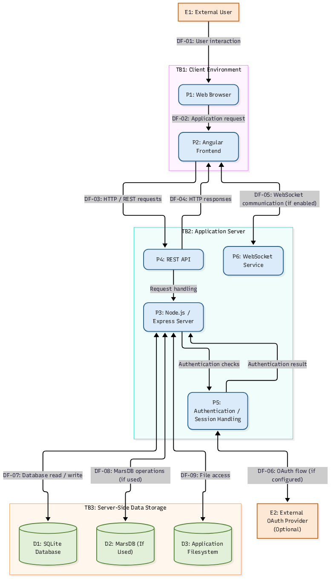

# OWASP Juice Shop — Threat Modelling

## 1. Overview

This document presents a threat-modelling assessment of the OWASP Juice Shop application.

Threat modelling is a structured security process used to understand how an application works, identify valuable assets, map potential attack surfaces, and evaluate threats that could compromise the confidentiality, integrity, or availability of the system.

Rather than focusing only on individual vulnerabilities, this assessment examines the application's broader architecture and the possible ways an attacker could interact with its components.

The assessment uses the **STRIDE threat-modelling methodology** to identify and categorize potential security threats.

## 2. Assessment Objectives

The objectives of this assessment are to:

- Understand the application's architecture and major components.
- Identify important assets and sensitive information.
- Map communication paths and data flows.
- Identify trust boundaries between system components.
- Examine exposed attack surfaces.
- Identify potential threats using STRIDE.
- Recommend security controls and mitigation strategies.

## 3. System Overview

OWASP Juice Shop is an intentionally vulnerable web application designed for security training, vulnerability research, and penetration-testing practice.

Its documented architecture includes technologies such as:

- **Frontend:** Angular-based web application.
- **Backend:** Node.js and Express.
- **API:** REST endpoints.
- **Database:** SQLite.
- **Real-time communication:** WebSocket functionality.
- **Authentication:** Application authentication and optional external OAuth integration.
- **Storage:** Server-side application storage.

The exact components and integrations should be validated against the version and configuration being assessed.

## 4. System Assets

The following assets are considered important to the application's security:

| Asset | Security importance |
|---|---|
| User accounts | Prevent unauthorized account access |
| Authentication credentials | Protect account confidentiality |
| Session tokens | Prevent session theft and misuse |
| Personal information | Protect user privacy |
| Application database | Protect stored information |
| Administrative functionality | Prevent unauthorized privileged actions |
| Application source and configuration | Prevent unauthorized modification |
| Uploaded files | Prevent unauthorized access or manipulation |

## 5. Architecture and Data Flow

The assessment considers the following major interactions:

1. A user accesses the application through a web browser.
2. The browser loads the frontend application.
3. The frontend communicates with the backend through HTTP requests and REST API endpoints.
4. The backend processes requests and performs application operations.
5. The backend communicates with the database and other server-side resources.
6. The application returns responses to the browser.
7. WebSocket connections support real-time communication where applicable.
8. External authentication providers may participate in authentication flows when configured.

### Data Flow Diagram

The conceptual architecture diagram is maintained separately:

**Note:** The diagram represents a conceptual architecture. Actual deployment details must be verified before treating every component or connection as confirmed.

## 6. Trust Boundaries

Trust boundaries identify where information crosses between components with different levels of trust.

| Boundary | Description | Security concern |
|---|---|---|
| Client boundary | User's browser and local environment | Untrusted input and client-side manipulation |
| Application boundary | Node.js and Express application | Unauthorized requests and server-side vulnerabilities |
| Data boundary | Database and server-side storage | Unauthorized access, modification, or disclosure |
| External identity boundary | Third-party identity provider, if configured | Authentication and token-handling risks |

All user-controlled input should be treated as untrusted until validated and safely processed.

## 7. Attack Surface Identification

The assessment considers these potential attack surfaces:

- Login and registration functionality.
- Password reset and account recovery.
- REST API endpoints.
- User input fields and search functionality.
- File upload and download functionality.
- Session and authentication mechanisms.
- WebSocket communication.
- Administrative interfaces.
- Database interactions.
- External authentication integrations, where enabled.

These are areas for investigation, not claims that every listed area is vulnerable.

## 8. STRIDE Threat Analysis

STRIDE is a threat-classification model used to identify six categories of security threats.

| STRIDE category | Potential threat | Security impact |
|---|---|---|
| Spoofing | Attacker impersonates another user | Unauthorized account access |
| Tampering | Attacker modifies application data or requests | Data integrity compromise |
| Repudiation | Actions cannot be reliably traced to an actor | Weak accountability |
| Information Disclosure | Sensitive information is exposed | Loss of confidentiality |
| Denial of Service | Application resources are exhausted | Service disruption |
| Elevation of Privilege | User gains unauthorized permissions | Administrative compromise |

Each potential threat should be investigated and supported with evidence before being reported as a confirmed vulnerability.

## 9. Security Controls and Mitigation

Potential security controls include:

- Strong authentication and secure password storage.
- Proper session management and token protection.
- Server-side authorization checks.
- Input validation and output encoding.
- Parameterized database queries.
- Secure file handling and access restrictions.
- Rate limiting and abuse prevention.
- Security logging and monitoring.
- Secure configuration and dependency management.
- Appropriate security controls for external authentication integrations.

## 10. Assessment Methodology

The threat-modelling process follows these stages:

1. **System Understanding:** Identify the application's components and how they interact.
2. **Asset Identification:** Determine what information and functionality require protection.
3. **Data Flow Mapping:** Document how information moves through the application.
4. **Trust Boundary Identification:** Identify transitions between trusted and untrusted components.
5. **Attack Surface Analysis:** Identify entry points that may be targeted.
6. **Threat Identification:** Apply STRIDE to identify potential threats.
7. **Risk Evaluation:** Assess the likelihood and potential impact of identified threats.
8. **Mitigation Planning:** Recommend appropriate security controls.

## 11. Scope and Limitations

This assessment focuses on the OWASP Juice Shop application and its documented application architecture.

The assessment does not assume that every documented feature is enabled in the local deployment.

Threats identified during modelling are potential risks. They must be validated through authorized testing before being classified as confirmed vulnerabilities.

Testing must remain within the authorized scope of the application.

## 12. Related Documentation

- [Main Project Documentation](../README.md)
- [Data Flow Diagram](../images/threat-model-dfd.png)
- [OWASP Juice Shop](https://owasp.org/www-project-juice-shop/)

## 13. Assessment Status

**Status:** Initial threat-modelling documentation.

Further work will include validating the deployed architecture, documenting specific threats, evaluating risk levels, and recording evidence from authorized testing.

---

*This document is part of the OWASP Juice Shop security research and documentation project.*
