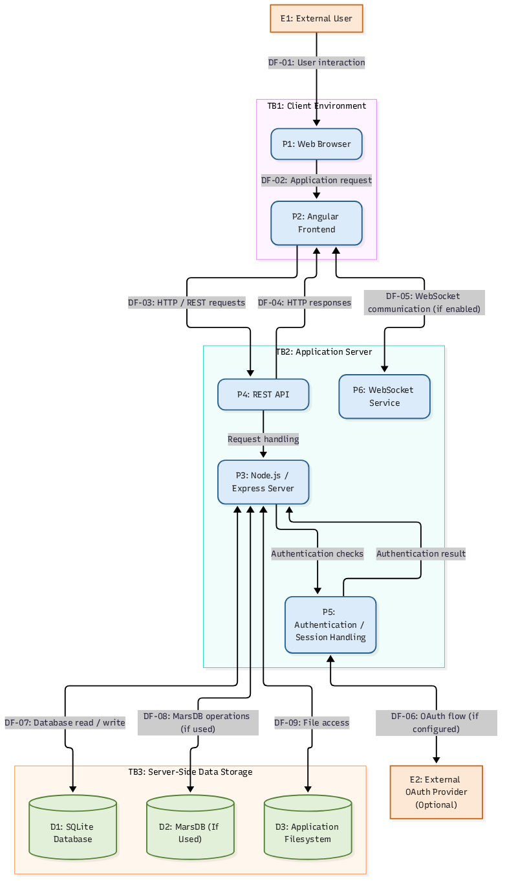

# OWASP Juice Shop — Detailed Threat Model

## 1. Executive Summary

This document presents a structured threat-modelling assessment of OWASP Juice Shop, an intentionally vulnerable web application developed for security education, vulnerability research, and penetration-testing practice.

The purpose of this assessment is to understand the application's architecture, identify important assets, examine data flows and trust boundaries, and evaluate potential security threats using the STRIDE methodology.

The assessment establishes a security-focused view of the application before investigating individual vulnerability challenges.

**Assessment approach:** Architecture-based threat modelling supported by available local installation evidence. Potential threats identified in this document are threat scenarios, not automatically confirmed vulnerabilities.

## 2. Assessment Objectives

The objectives are to:

- Understand the application's major architectural components.
- Identify sensitive assets and information requiring protection.
- Map communication between external entities, application processes, and data stores.
- Identify trust boundaries and possible attack surfaces.
- Evaluate threats using the STRIDE methodology.
- Recommend security controls and mitigation strategies.
- Establish a foundation for subsequent vulnerability investigation.

## 3. Assessment Scope

### In Scope

The assessment considers the following components:

- Browser-based client application.
- Angular frontend.
- Node.js and Express application server.
- REST API endpoints.
- Authentication and session-management functionality.
- Application data storage.
- SQLite database.
- File-based application resources.
- User interactions and application responses.

### Out of Scope

The following are excluded unless explicitly examined in a separate assessment:

- The underlying Kali Linux operating system.
- VirtualBox host security.
- Wazuh infrastructure.
- External Google infrastructure.
- Third-party OAuth provider infrastructure.
- Unrelated network services.
- Production infrastructure not represented by the local installation.

### Assessment Environment

| Property | Description |
|---|---|
| Application | OWASP Juice Shop |
| Installed package version | 19.1.1 |
| Backend runtime | Node.js |
| Node.js version | v24.19.0 |
| Frontend | Angular |
| Backend framework | Express |
| Database | SQLite |
| Deployment | Local Kali Linux installation |
| Intended access | Local testing environment |
| Application address | `http://127.0.0.1:42000` |

The application address represents the intended local endpoint. Successful application availability has not yet been established.

## 4. System Architecture

OWASP Juice Shop follows a client-server architecture.

The frontend is implemented using Angular and provides the browser-based user interface. The backend uses Node.js and Express to serve application resources and process client requests through REST APIs.

The backend interacts with application storage, including SQLite and file-based resources. The official architecture documentation also identifies MarsDB as an additional data store and describes WebSocket notifications and OAuth 2.0 registration as application capabilities.

These additional capabilities must be verified against the installed version and configuration before being treated as active components in this particular deployment.

### 4.1 Architectural Components

| Component | Responsibility | Security relevance |
|---|---|---|
| Browser | Displays the application and sends requests | Untrusted client environment |
| Angular frontend | Provides application interface and client-side logic | Client-side manipulation and XSS exposure |
| Express server | Processes HTTP requests and application logic | Main application attack surface |
| REST API | Handles client-server communication | Authentication, authorization and input validation |
| Authentication | Manages user identity and access | Credential theft and session compromise |
| SQLite | Stores relational application data | Unauthorized data access and modification |
| MarsDB | Additional application data storage | NoSQL injection and unauthorized access |
| File storage | Holds application resources and documents | Unauthorized file access and disclosure |
| WebSocket | Supports real-time notifications | Potential unauthorized event access |
| OAuth 2.0 | Supports external identity-based registration | Authentication and redirect-flow risks |

## 5. Assets Identification

Assets are resources, information, or capabilities that could be targeted by an attacker.

| Asset ID | Asset | Security importance |
|---|---|---|
| A-01 | User credentials | Prevent unauthorized account access |
| A-02 | Authentication tokens and sessions | Prevent session hijacking |
| A-03 | User account information | Protect confidentiality and integrity |
| A-04 | Customer and basket information | Prevent unauthorized disclosure or modification |
| A-05 | Application database | Protect stored application information |
| A-06 | Administrative functionality | Prevent unauthorized privileged operations |
| A-07 | Application source and configuration | Prevent unauthorized modification |
| A-08 | Uploaded and downloadable files | Prevent unauthorized access and tampering |
| A-09 | Application availability | Maintain service availability |
| A-10 | Security and application logs | Preserve investigation and accountability records |

## 6. Trust Boundaries

Trust boundaries identify where information crosses between environments with different levels of trust.

### TB-01: Browser-to-Server Boundary

The browser is outside the application's server-side trust boundary.

All incoming requests must be treated as untrusted, regardless of whether they originate from the normal application interface.

Potential risks include:

- Parameter manipulation.
- Cross-site scripting.
- Request forgery.
- Unauthorized API requests.
- Malicious input submission.

### TB-02: Application-to-Database Boundary

The backend communicates with application databases to retrieve and modify information.

Potential risks include:

- SQL injection.
- NoSQL injection.
- Unauthorized database operations.
- Exposure of sensitive records.
- Improper database access controls.

### TB-03: Application-to-File-System Boundary

The application accesses files stored within its deployment environment.

Potential risks include:

- Path traversal.
- Unauthorized file disclosure.
- File modification.
- Insecure file handling.

### TB-04: Application-to-External-Identity Boundary

Where OAuth 2.0 functionality is configured, authentication-related communication crosses into an external identity provider.

Potential risks include:

- Improper redirect validation.
- Authentication-flow manipulation.
- Account-linking weaknesses.
- Exposure of authorization information.

This boundary is conditional on the relevant integration being enabled.

## 7. Data Flow Analysis

The Data Flow Diagram illustrates the application's major components and the movement of information between them.

### 7.1 Primary Data Flows

| Flow | Source | Destination | Description |
|---|---|---|---|
| DF-01 | User | Browser | User submits application requests and information |
| DF-02 | Browser | Application server | HTTP requests and API calls |
| DF-03 | Application server | Browser | Application responses and resources |
| DF-04 | Application server | SQLite | Database queries and updates |
| DF-05 | Application server | MarsDB | Additional data operations, where applicable |
| DF-06 | Application server | File storage | File reads and writes |
| DF-07 | Application server | Browser | Real-time notifications, where applicable |
| DF-08 | Application server | External identity provider | OAuth authentication exchange, where configured |

All incoming data should be validated on the server side. Client-side validation alone must not be considered a security control.

## 8. STRIDE Threat Analysis

STRIDE is a threat-classification methodology used to identify six categories of security threats:

- Spoofing
- Tampering
- Repudiation
- Information Disclosure
- Denial of Service
- Elevation of Privilege

The following scenarios identify potential threats based on the application's architecture and intentionally vulnerable training environment.

### 8.1 Spoofing

**Definition:** An attacker impersonates a legitimate user, application, or system component.

| Threat ID | Threat scenario | Potential impact |
|---|---|---|
| S-01 | Attacker obtains valid user credentials | Unauthorized account access |
| S-02 | Attacker steals or reuses an authentication token | Session compromise |
| S-03 | Attacker manipulates an authentication flow | Unauthorized identity association |

**Recommended security controls:**

- Secure password hashing.
- Strong authentication controls.
- Secure session management.
- Token expiration and invalidation.
- Proper OAuth state and redirect validation.

### 8.2 Tampering

**Definition:** An attacker modifies data, requests, application resources, or system functionality without authorization.

| Threat ID | Threat scenario | Potential impact |
|---|---|---|
| T-01 | Attacker modifies API parameters | Unauthorized application operations |
| T-02 | Attacker manipulates basket or product information | Data integrity compromise |
| T-03 | Attacker submits malicious database input | Unauthorized database modification |
| T-04 | Attacker modifies application files | Application integrity compromise |

**Recommended security controls:**

- Server-side input validation.
- Parameterized database queries.
- Authorization checks on sensitive operations.
- File integrity controls.
- Strict validation of state-changing requests.

### 8.3 Repudiation

**Definition:** A user or attacker performs an action and subsequently denies having performed it.

| Threat ID | Threat scenario | Potential impact |
|---|---|---|
| R-01 | User performs an unauthorized transaction without sufficient audit records | Reduced accountability |
| R-02 | Attacker manipulates application activity | Difficulty reconstructing events |
| R-03 | Sensitive administrative actions are not adequately logged | Incomplete security investigations |

**Recommended security controls:**

- Centralized security logging.
- Accurate timestamps.
- Audit trails for sensitive actions.
- Protection against unauthorized log modification.
- Monitoring of authentication and administrative events.

### 8.4 Information Disclosure

**Definition:** Sensitive information becomes accessible to unauthorized individuals.

| Threat ID | Threat scenario | Potential impact |
|---|---|---|
| I-01 | Attacker accesses another user's information | Privacy compromise |
| I-02 | Attacker retrieves sensitive files | Confidentiality compromise |
| I-03 | Database errors expose internal information | Information leakage |
| I-04 | Application responses reveal sensitive implementation details | Increased attack surface |
| I-05 | Authentication information is exposed | Account compromise |

**Recommended security controls:**

- Enforce object-level authorization.
- Restrict sensitive file access.
- Avoid exposing internal errors.
- Apply appropriate response filtering.
- Protect credentials and authentication tokens.

### 8.5 Denial of Service

**Definition:** An attacker disrupts or degrades the availability of an application or its resources.

| Threat ID | Threat scenario | Potential impact |
|---|---|---|
| D-01 | Attacker submits excessive requests | Application resource exhaustion |
| D-02 | Expensive operations are repeatedly triggered | Performance degradation |
| D-03 | Malicious input causes resource-intensive processing | Service disruption |
| D-04 | Database resources are exhausted | Application availability loss |

**Recommended security controls:**

- Rate limiting.
- Request-size restrictions.
- Resource consumption limits.
- Query optimization.
- Monitoring and alerting.

### 8.6 Elevation of Privilege

**Definition:** An attacker gains permissions beyond those assigned to their account.

| Threat ID | Threat scenario | Potential impact |
|---|---|---|
| E-01 | Normal user accesses administrative functionality | Unauthorized administrative access |
| E-02 | Attacker manipulates object identifiers to access another user's records | Broken object-level authorization |
| E-03 | Attacker bypasses role-based restrictions | Privilege escalation |
| E-04 | Attacker exploits insecure server-side authorization | Unauthorized privileged operations |

**Recommended security controls:**

- Server-side authorization enforcement.
- Role-based access control.
- Object-level ownership verification.
- Least-privilege principles.
- Authorization testing across API endpoints.

## 9. Attack Surface Analysis

The application's attack surface consists of interfaces and components through which an attacker may interact with the system.

| Attack surface | Potential security concern |
|---|---|
| Web interface | Cross-site scripting and client-side manipulation |
| REST API | Broken access control and injection |
| Authentication endpoints | Credential attacks and authentication weaknesses |
| User input fields | Injection and improper input validation |
| Database operations | SQL and NoSQL injection |
| File handling | Path traversal and unauthorized file access |
| Administrative endpoints | Privilege escalation |
| WebSocket communication | Unauthorized event access, if enabled |
| OAuth integration | Authentication-flow weaknesses, if configured |

The existence of an attack surface does not establish that a vulnerability is present. Each concern requires separate validation.

## 10. Risk Prioritization

The following table provides an initial qualitative prioritization of threat scenarios.

| Threat category | Potential severity | Priority |
|---|---|---|
| Spoofing | High | High |
| Tampering | High | High |
| Repudiation | Medium | Medium |
| Information Disclosure | High | High |
| Denial of Service | Medium | Medium |
| Elevation of Privilege | Critical | Critical |

These are preliminary assessment priorities, not calculated CVSS scores or confirmed findings. Actual risk depends on exploitability, affected assets, security controls, and business impact.

## 11. Security Recommendations

The following controls should be considered when evaluating the application's security posture:

1. Enforce authentication and authorization on the server side.
2. Validate and sanitize untrusted input.
3. Use parameterized queries for database operations.
4. Apply object-level access controls.
5. Protect sensitive files and application resources.
6. Implement secure session and token management.
7. Apply rate limiting and resource restrictions.
8. Record security-relevant application events.
9. Avoid exposing sensitive internal errors.
10. Review third-party integrations and authentication flows.
11. Maintain secure configuration and dependency management.
12. Perform regular security testing against identified attack surfaces.

## 12. Assessment Limitations

This threat model is an architecture-based assessment, not a complete source-code audit or penetration-test report.

The following limitations apply:

- The local application has not yet completed a successful startup during this assessment.
- The precise runtime configuration has not been fully inspected.
- Optional integrations have not been confirmed as active.
- Individual threat scenarios have not all been experimentally validated.
- No claim is made that every listed threat is exploitable in the installed version.

Further validation should include application startup verification, endpoint enumeration, source-code review, authentication testing, authorization testing, and controlled security testing.

## 13. Conclusion

The threat-modelling exercise establishes a structured understanding of the OWASP Juice Shop application, its architecture, important assets, data flows, trust boundaries, and potential security threats.

The STRIDE methodology provides a systematic way to evaluate risks across the application's major components rather than focusing exclusively on individual vulnerabilities.

The identified threat scenarios establish a foundation for subsequent security assessments, including reconnaissance, API enumeration, authentication testing, access-control testing, injection testing, and vulnerability validation.

The next stage of this project will investigate individual security weaknesses, document supporting evidence, assess their impact, and identify appropriate remediation strategies.

## 14. References

1. OWASP Juice Shop — Official Project Overview: https://owasp.org/projects/juice-shop
2. Pwning OWASP Juice Shop — Architecture Overview: https://help.owasp-juice.shop/introduction/architecture.html
3. Pwning OWASP Juice Shop — Codebase Overview: https://help.owasp-juice.shop/part3/codebase.html
4. OWASP Developer Guide — Juice Shop: https://devguide.owasp.org/en/07-training-education/01-vulnerable-apps/01-juice-shop/
5. OWASP Threat Modeling: https://owasp.org/www-community/Threat_Modeling
